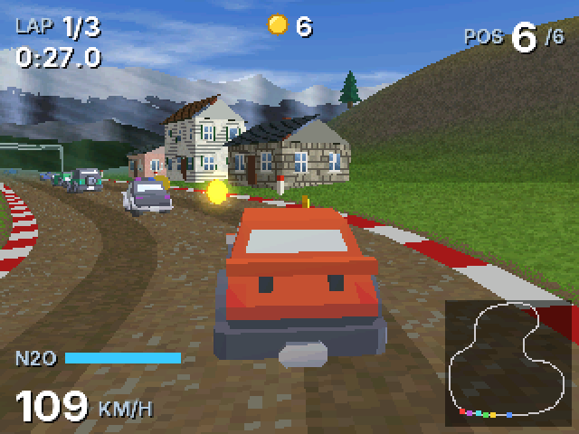
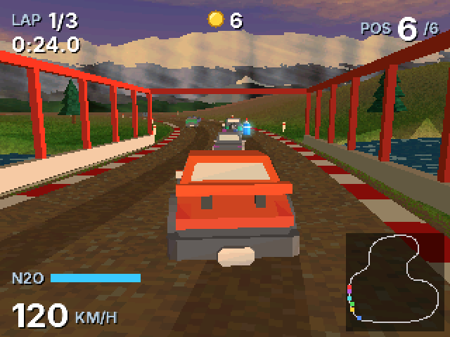
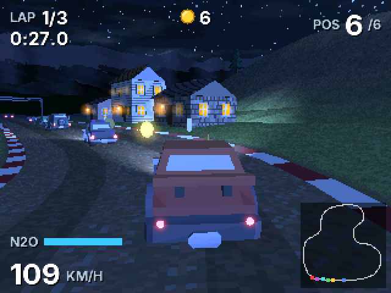
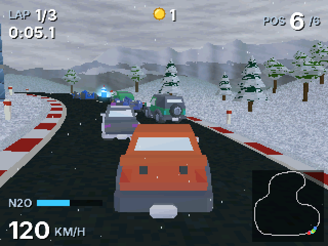
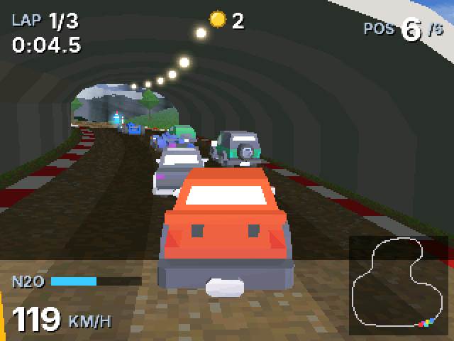
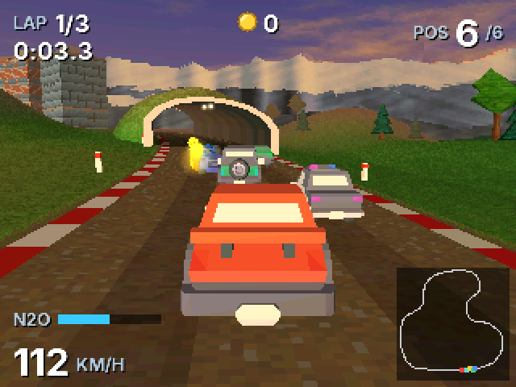

# luckfox_car_game

A textured 3D rally game for the Luckfox Pico Mini B and an ILI9341 display, built on [luckfox_tft_ili9341](https://github.com/pahasara2003/luckfox_tft_ili9341) (git submodule in `lib/ili9341`).

Clone with `git clone --recurse-submodules`.

Race five AI cars over 3 laps, driving with your PC's keyboard over the USB `adb` link.

## Screenshots

These are 320×240 frames rendered by the host simulation (`./cargame ppm`), shown at 2× size. They're the same pixels the game sends to the panel.

| Day: the village by the start straight | Golden hour: over the truss bridge |
| --- | --- |
|  |  |
| **Morning:** through the village | **Night:** lit windows and porch lamps |
|  |  |
| **Rain:** a glowing nitrous tank ahead | **Snow on asphalt** |
|  |  |
| **Nitrous:** plasma jets off the start line | **Tunnel:** through the hill on the start straight |
|  |  |
| **Tunnel mouth** at golden hour | |
|  | |

## Features

- **A living landscape:** rolling hills coloured by height and slope, from lush valleys to dry hilltops and rocky slopes. There's a lake beside the start straight and a river under a red steel truss bridge.
- **Buildings:** a village of houses, each with its own size, storeys, and brick, plank, stone or plaster walls under tiled roofs. Tower blocks stand on the east straight. At night their windows light up and porch lamps glow.
- **A tunnel:** the start straight runs through a grassy hill. It has a concrete arch, ceiling lamps, a dimmer interior and a frame round each mouth. At night your headlights light the walls.
- **Coins and nitrous:** short rows of glowing gold coins and blue nitrous tanks. They all come back each lap.
- **Conditions:** night, morning, day or golden hour; sunny, rain or snow; gravel or asphalt. Each changes grip and the look of the world.
- **Real handling:** a tyre model with drifting. Cars tilt and change speed on slopes (up to a 14% grade).
- **Six cars:** six distinct models, each AI with its own line, corner speed and top speed.
- **HUD:** lap, race time, best lap, position, coins, nitrous gauge, speed and a minimap.

## Build and play

Wire the display as in the [library README](lib/ili9341/README.md#wiring-luckfox-pico-mini-b-example), connect the board over USB, then:

```sh
make deploy                # cross-compile with the Luckfox SDK toolchain, push to /root/cargame and the car models to /root/assets/cars
python3 tools/drive.py     # prepare the board, start the game, open the controller window
```

Keep the controller window focused: tap **Up/W** once and the car keeps driving, **Down/S** brakes (and stops the auto-throttle), **Left/Right** steer, hold **Space** (or **Shift**) for nitrous, **R** restarts, and **Esc** quits. Add `flip` (`python3 tools/drive.py flip`) if the picture is upside down.

**T** cycles time (night, morning, day, golden hour), **C** cycles weather (sunny, rain, snow), and **G** switches between gravel and asphalt. The controller shows the current combination, and changes take effect during the race. Asphalt has more grip than gravel. Rain reduces grip, and snow reduces it further. At night a blue moon lights the hills, every car has glowing red tail lights, and your headlights (and the nearest rival's) light the road.

**Nitrous.** You start with half a tank, and each tank you pick up adds about a third. A full tank boosts for 3 seconds: the car pulls harder and reaches about 180 km/h instead of 150. Plasma jets shoot from the exhausts (a white-hot core, a blue sheath, shock diamonds and a glow on the road), speed streaks flash at the screen edge and the view widens. When the tank runs dry, the car eases back to its normal top speed.

**Driving and drifting.** Hold **Left** or **Right** at speed for more than about a third of a second and the car drifts: the car swings smoothly round even the tight bends at full throttle (90° in about 55 units). Let go and it straightens up. Short taps steer normally. Under the drift, the cars use a tyre model: 4WD with a rear-biased torque split, tyres that grip up to a limit and then slide, ABS brakes, and weight that moves between the axles. Tapping **Down** into a bend also swings the tail out. The AI drives the same way, on the keys with the drift. Each car has its own corner and top speed. A car that's blocked pulls out to pass, and cars far behind you find a little extra pace, so the race stays close.

`make deploy` expects the SDK at `~/luckfox-pico`; pass `CROSS=/path/to/arm-rockchip830-linux-uclibcgnueabihf-g++` otherwise.

**Board with the ESP32 Wi-Fi image:** `drive.py` hands SPI0 from the Wi-Fi driver to `spidev` and holds the ESP32 in reset, because the ESP32 shares the display's D/C and backlight pins (see the library README). Wi-Fi is off until the next reboot.

## Other modes

```sh
make cargame                         # host build of the same game
python3 tools/drive.py sim           # play it on the PC, no board: shows the exact bytes the panel would get, 2x size
./cargame ppm 14 a night rain asphalt > frame.ppm  # keys: u d l r n (nitrous), a = autopilot; optional time, climate and road
./cargame bench 200 day sunny gravel                # render-only timing; same optional conditions
adb shell /root/cargame demo         # on the board: attract mode, no controller needed
make test                            # engine and game self-checks on the host
```

Use `night`, `morning`, `day` or `evening` for time, `sunny`, `rain` or `snow` for weather, and `gravel` or `asphalt` for the road. The defaults are day, sunny and gravel.

## Layout

| File | What it is |
| --- | --- |
| `src/engine3d.h` | Software rasterizer: camera, near-plane clipping, perspective-correct textures, 1/z depth buffer, flat lighting, fog, spot and rim lights |
| `src/objload.h` | OBJ/MTL loader with colours and PPM textures (`assimp export` and `magick` convert other formats) |
| `src/game.h` | Track, terrain heights with the lake and river, buildings and bridge placement, coins and nitrous, the tunnel's range and walls, car physics, AI, laps and positions; no rendering |
| `src/cargame.cpp` | Textures, meshes (houses, towers, bridge, tunnel, water, coins, tanks), plasma jets, HUD, display thread and input for the game |
| `src/font_hud.h` | Anti-aliased Inter HUD font bitmaps, glyph metrics and data tables |
| `src/demo3d.cpp` | Model viewer demo with spot lights (`demo3d FRAMES display MODEL.obj`) |
| `tools/drive.py` | PC keyboard controller |
| `tools/mkfont.py` | Font header generator: renders Inter font sizes/weights to C++ headers |
| `assets/cars/` | Car models from Kenney's [Car Kit](https://kenney.nl/assets/car-kit) (CC0), palette texture converted to PPM |

## Performance

On the Pico Mini B (single Cortex-A7, 1.1 GHz), `cargame bench 200` measures about 35 ms per frame by day and 47 ms at night. That's rendering alone, without the display. The game runs at roughly 20 fps by day and less at night. Frames are sent to the display on a second thread while the next one renders.

On the development PC (Intel Core i5-1235U), `cargame bench 600` (pinned to one core with `taskset`) measures about 7 ms per frame by day and 9 ms at night.

The buildings, bridge and water are built in code from a few hundred flat-coloured triangles. Kenney's ready-made houses are 1,500 to 4,000 triangles each, which is too many for the single Cortex-A7.

Full speed needs the `pushImage` change in `lib/ili9341` that packs pixels into 4 KB SPI writes. With the original one-write-per-row code the game runs at about 17 fps.

## Credits

Game by [pahasara2003](https://github.com/pahasara2003), built with help from Claude Code.

Car models: sedan-sports, hatchback-sports, race, race-future, SUV and police from [Kenney](https://kenney.nl) Car Kit 3.1, CC0 (`assets/cars/LICENSE-Kenney-Car-Kit.txt`).
HUD font: [Inter](https://rsms.me/inter/) by Rasmus Andersson, SIL Open Font License 1.1 (`assets/LICENSE-Inter.txt`).
