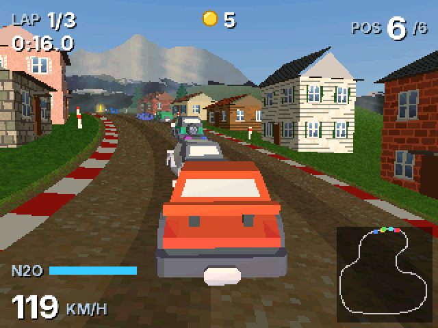
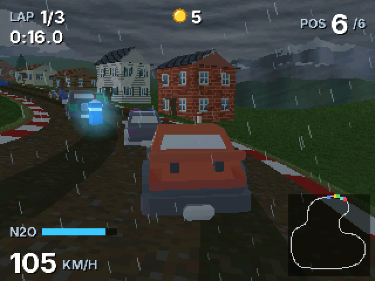
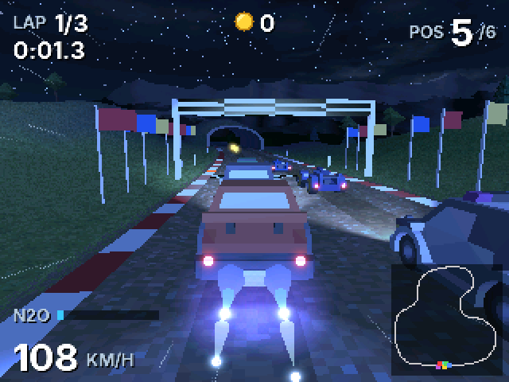

# luckfox_car_game

A textured 3D rally game that runs on a tiny **Luckfox Pico Mini B** board with a 2.4" **ILI9341** screen. Race five AI cars over 3 laps through hills, a village, over a river bridge and through a tunnel, using three push buttons or your PC keyboard.

The display driver is [luckfox_tft_ili9341](https://github.com/pahasara2003/luckfox_tft_ili9341), included as a git submodule in `lib/ili9341`. Clone with:

```sh
git clone --recurse-submodules https://github.com/pahasara2003/luckfox_car_game
```

## Screenshots

These are real 320×240 frames from the game (rendered by the host simulation), shown at 2× size.

| Day: the village by the start straight | Golden hour: over the truss bridge |
| --- | --- |
|  |  |
| **Morning:** through the village | **Night:** lit windows and porch lamps |
|  |  |
| **Rain:** a glowing nitrous tank ahead | **Snow on asphalt** |
|  |  |
| **Nitrous:** plasma jets off the start line | **Tunnel:** through the hill on the start straight |
|  |  |
| **Tunnel mouth** at golden hour | |
|  | |

## How to play

### The race

- You start in 6th place behind five AI cars. The race is **3 laps**, after a short countdown on the grid.
- Collect **gold coins** (the HUD counts them) and **blue nitrous tanks** to fill your boost. They all come back every lap.
- The screen shows your lap, race time, best lap, position, coins, nitrous gauge, speed and a minimap.

### Start menu

The game opens on a **race setup** menu: a row of cards for **time**, **weather**, **road** and **start**, each with a small preview picture, over a view of the starting grid in the chosen conditions.

| Press | What happens |
|---|---|
| **Left / Right** | pick a card |
| **Middle** | change that card's option, or start the race on **GO!** |

**Up** on the PC keyboard also starts the race. When you finish, the result stays on screen for 6 seconds, then the menu comes back for a new race.

### Controls with the 3 buttons

The car **accelerates by itself**; you only steer, boost and brake.

| Press | What happens |
|---|---|
| **Left** | steer left |
| **Right** | steer right |
| **Middle** | nitrous boost (while held) |
| **Left + Right together** | brake; keep holding after the car stops and it reverses |

### Controls with the PC keyboard

Run `python3 tools/drive.py` and keep its window focused. The keyboard works alongside the buttons.

| Key | What happens |
|---|---|
| **Up / W** | tap once and the car keeps accelerating |
| **Down / S** | brake (and stop the auto-throttle); reverse when stopped |
| **Left / Right** | steer |
| **Space** or **Shift** | nitrous (while held) |
| **T** | change time: night, morning, day, golden hour |
| **C** | change weather: sunny, rain, snow |
| **G** | switch road: gravel or asphalt |
| **R** | restart the race |
| **Esc** | quit |

### Driving tips

- **Drifting:** hold Left or Right at speed for more than about a third of a second and the car slides into a drift. It swings round even tight bends at full speed. Let go and it straightens up. Short taps steer normally.
- **Nitrous:** you start with half a tank, and each tank you collect adds about a third. A full tank lasts 3 seconds and takes you from about 150 to 180 km/h, with plasma jets from the exhausts and a wider view.
- **Grip:** asphalt grips better than gravel. Rain makes the road slippery, and snow even more so.
- **Hills:** cars slow down uphill and speed up downhill (slopes up to 14%).
- **The AI:** every rival has its own line, corner speed and top speed. They overtake when blocked, and cars far behind catch up a little, so the race stays close.
- **Night:** a blue moon lights the hills, cars glow with red tail lights, and your headlights light the road and the tunnel walls.

## What you need

- Luckfox Pico Mini B
- 2.4" ILI9341 SPI display (240×320)
- 3 push buttons
- Jumper wires and a good USB cable to your PC

## Wiring

Pin numbers are the board's physical side pads, 1 to 24.

### Display

| Display pin | Board pin | Signal |
|---|---:|---|
| VCC | 3 | 3V3 |
| GND | 2 or 21 | GND |
| SCK / CLK | 7 | SPI0 clock |
| DIN / MOSI | 8 | SPI0 MOSI |
| SDO / MISO | 9 | SPI0 MISO |
| CS | 13 | GPIO1_D1 |
| DC / RS | 10 | GPIO1_C4 |
| RST | 16 | GPIO1_C6 |
| LED / BL (backlight) | 11 | GPIO1_C5 |

Check your module's voltage and backlight circuit before connecting. Keep the backlight on pin 11 rather than straight on 3V3: the extra current on 3V3 can dim the screen and reset the panel.

### Buttons

Wire each button between its pin and **GND**. The game turns on the internal pull-ups, so a pressed button reads low. If your kernel ignores the pull-ups, add a 10 kΩ resistor from each button pin to 3V3.

| Button | Board pin | Signal | gpiochip1 line |
|---|---:|---|---:|
| Left | 17 | GPIO1_C7 | 23 |
| Middle (nitrous) | 14 | GPIO1_D2 | 26 |
| Right | 15 | GPIO1_D3 | 27 |

## Build and run

You need the Luckfox SDK at `~/luckfox-pico` for the cross-compiler (or pass `CROSS=/path/to/arm-rockchip830-linux-uclibcgnueabihf-g++`).

```sh
make deploy                # build for the board and copy the game and car models to /root
python3 tools/drive.py     # set up the board, start the game and open the keyboard window
```

To play with only the buttons and no PC, make the game start at every boot:

```sh
make autostart             # installs /etc/init.d/S99zcargame and parks the Wi-Fi boot script (undo: see the Makefile)
```

This is for a board with the ESP32 removed: it moves the board's `S98esp32wifi` boot script to `/root/S98esp32wifi.disabled`, because its Wi-Fi driver takes the display's SPI bus. The board then opens the start menu about 15 seconds after power-on, and the game keeps running when you unplug the PC. `drive.py` still works: it stops the autostarted copy and starts its own.

Options: `night`, `morning`, `day` or `evening` for the time; `sunny`, `rain` or `snow` for the weather; `gravel` or `asphalt` for the road. The defaults are day, sunny and gravel. The picture is turned 180° to match how the panel is mounted; add `flip` if it's upside down on yours.

**ESP32 Wi-Fi image:** on a board that still has the ESP32, its Wi-Fi driver takes SPI0 and shares the display's DC and backlight pins. `drive.py` hands SPI0 to `spidev` and holds the ESP32 in reset, until the next reboot. With the ESP32 removed and `make autostart` installed, the boot script does this for you.

## Other modes

```sh
make cargame                         # build the game for your PC
python3 tools/drive.py sim           # play on the PC without a board
./cargame ppm 14 a night rain asphalt > frame.ppm  # save one frame (keys: u d l r n, a = autopilot)
./cargame bench 200 day sunny gravel                # time the renderer
./cargame menu 1 night snow > menu.ppm              # save the start menu (1 = second card highlighted)
adb shell /root/cargame demo         # attract mode on the board: the car drives itself
make test                            # self-checks for the engine and game
```

## Performance

On the Pico Mini B (one Cortex-A7 core at 1.1 GHz), rendering takes about 35 ms per frame by day and 47 ms at night. The game runs at roughly 20 fps by day and a little less at night. Frames go to the display on a second thread while the next one renders.

On a PC (Intel Core i5-1235U, one core), a frame takes about 7 ms by day and 9 ms at night.

The buildings, bridge and water are made in code from a few hundred flat-coloured triangles, because ready-made 3D houses (1,500 to 4,000 triangles each) are too heavy for the single core. Full speed also needs the `pushImage` change in `lib/ili9341` that sends pixels in 4 KB SPI writes; without it the game runs at about 17 fps.

## Project files

| File | What it is |
| --- | --- |
| `src/engine3d.h` | The 3D software renderer: camera, clipping, textures, depth buffer, lighting, fog |
| `src/game.h` | Track, terrain, buildings, coins and nitrous, car physics, AI, laps (no drawing code) |
| `src/cargame.cpp` | Textures, 3D models, sky, HUD, display thread, buttons and keyboard input |
| `src/objload.h` | Loader for OBJ/MTL 3D models with PPM textures |
| `src/font_hud.h` | Inter font bitmaps for the HUD |
| `src/demo3d.cpp` | Model viewer demo (`demo3d FRAMES display MODEL.obj`) |
| `tools/drive.py` | PC keyboard controller and board setup |
| `tools/S99zcargame` | Boot script that starts the game without a PC (`make autostart`) |
| `tools/mkfont.py` | Generates the HUD font header |
| `assets/cars/` | Car models from Kenney's [Car Kit](https://kenney.nl/assets/car-kit) |

## Credits

Game by [pahasara2003](https://github.com/pahasara2003), built with help from Claude Code.

Car models: sedan-sports, hatchback-sports, race, race-future, SUV and police from [Kenney](https://kenney.nl) Car Kit 3.1, CC0 (`assets/cars/LICENSE-Kenney-Car-Kit.txt`).
HUD font: [Inter](https://rsms.me/inter/) by Rasmus Andersson, SIL Open Font License 1.1 (`assets/LICENSE-Inter.txt`).
